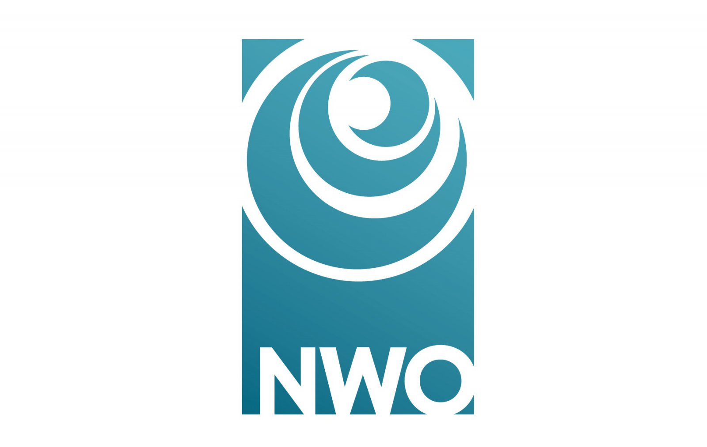
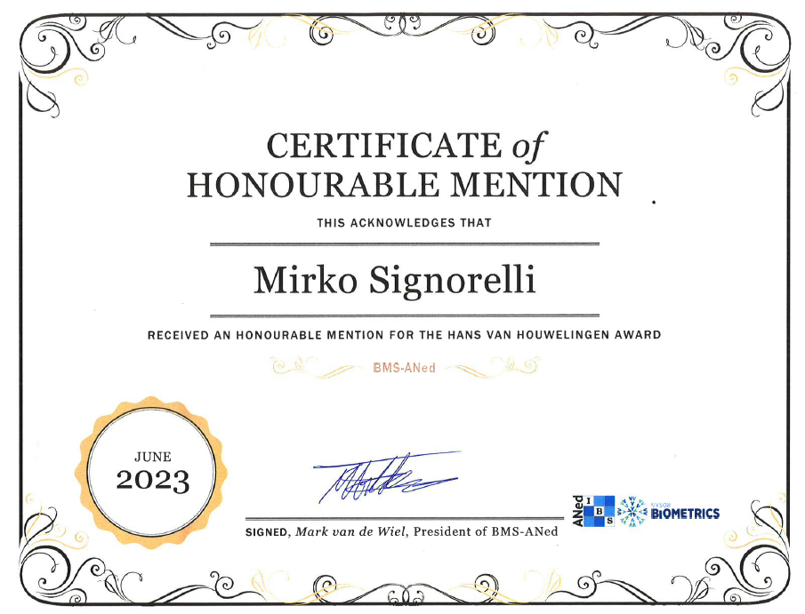
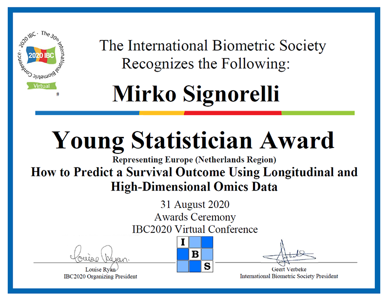
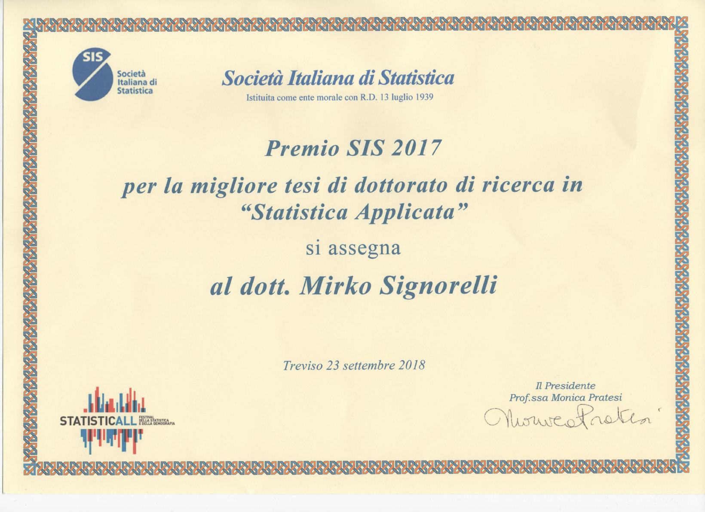
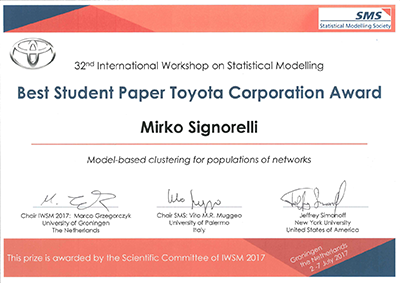
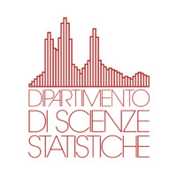

### Vidi grant (NWO - Dutch Research Council)

In October 2024, the Dutch Research Council (NWO) awarded me a [**Vidi grant**](https://www.nwo.nl/en/calls/nwo-talent-programme). A "Vidi" is a personal research grant that provides researchers with funding to develop their own innovative research line and build an independent research group.

[My research project](https://www.nwo.nl/projecten/ssxqw87450) focuses on the development of **new statistical methods and software** for **dynamic prediction** in settings with numerous longitudinal predictors and complex survival outcomes.

### Hans van Houwelingen Award: honourable mention (BMS-ANed)

In June 2023, my article [Poisson-Tweedie mixed-effects model: a flexible approach for the analysis of longitudinal RNA-seq data](https://journals.sagepub.com/doi/10.1177/1471082X20936017) was awarded a **honourable mention by the jury of the Hans van Houwelingen Biometry Award**. This prize is awarded every two years to a publication that has contributed significantly to the development or application of biometry. 

### e-Science Center Fellowship

In June 2023, the Netherlands eScience Center awarded me an **eScience Center Fellowship**. The fellowship programme, now discontinued, supported researchers in developing, improving and promoting the use of open and sustainable research software. 

[My fellowship project](https://www.esciencecenter.nl/fellowship-programme/mirko-signorelli/) contributed to improving the efficiency, accessibility and visibility of the `R` package `pencal` (see the [`R` packages](r.html) page for info about it).

### Young Statistician Award (International Biometric Society)

In August 2020, I was awarded the [**Young Statistician Award of the International Biometric Society**](https://www.vvsor.nl/biometrics/news/two-awards-for-bms-aned-members-at-ibc2020) (IBS). My short paper, entitled "How to predict a survival outcome using longitudinal and high-dimensional omics data", was the winner for European macroregion of IBS. Its contents were presented during the [Young Statistician Showcase session of IBC2020](https://www.ibc2020.org/scientific-programme/showcases).

### Best PhD Thesis Award (Italian Statistical Society)

In June 2018, the Italian Statistical Society (SIS) awarded me their **Best PhD Thesis Award in Applied Statistics** for [my PhD thesis](https://www.researchgate.net/publication/322746472_Inferring_Community-driven_Structure_in_Complex_Networks). The prize is awarded every other year to the best PhD theses in statistics and demography.

After receiving the award, I was interviewed by the Italian newspaper *Corriere della Sera*; [you can read the interview (in Italian) here](https://bergamo.corriere.it/notizie/cronaca/18_ottobre_05/da-chiuduno-all-olanda-premiato-la-ricerca-statistica-politica-8bce14cc-c87b-11e8-81ab-863c582a99f0.shtml).

### Best Student Paper Award (Statistical Modelling Society)

In July 2017, the Statistical Modelling Society awarded me the [**Best Student Paper Toyota Corporation Award**](https://journals.sagepub.com/doi/full/10.1177/1471082X17726638) at the 32nd International Workshop on Statistical Modelling (IWSM).

### Research Award 2016 (Dept. of Statistics, University of Padova)

In 2017, the Department of Statistical Sciences of the University of Padova awarded me the **Research Award 2016 of ** for my article [NEAT: an efficient network enrichment analysis test](https://bmcbioinformatics.biomedcentral.com/articles/10.1186/s12859-016-1203-6).

<!-- the part below is a fix to the menu not displaying properly
on the mobile version -->

